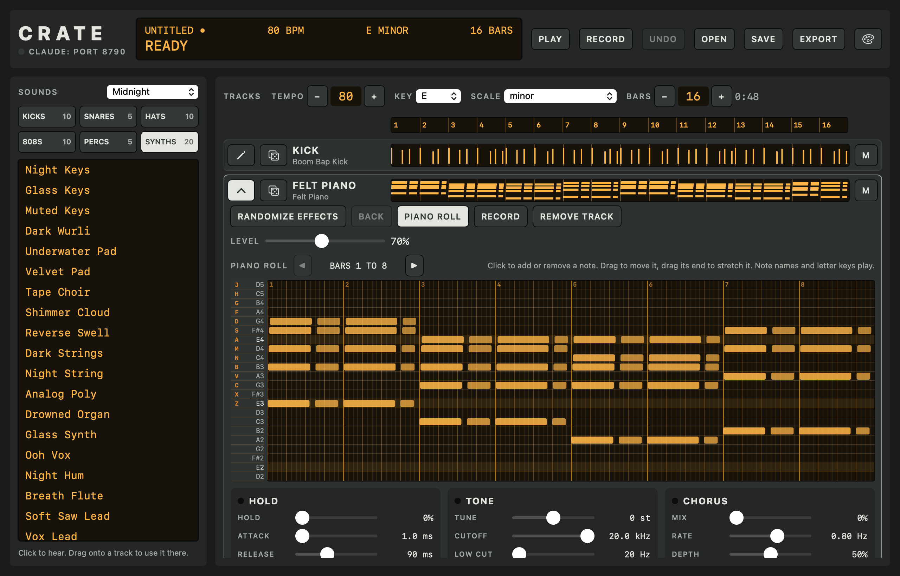
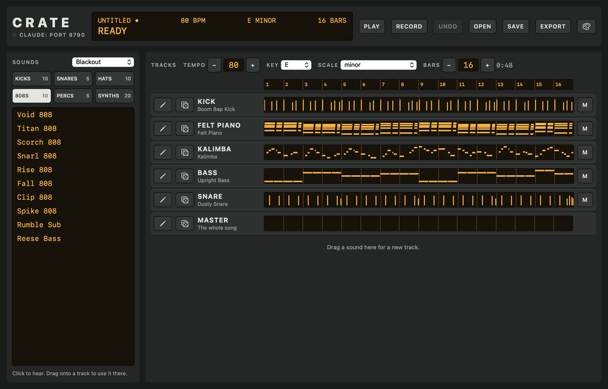
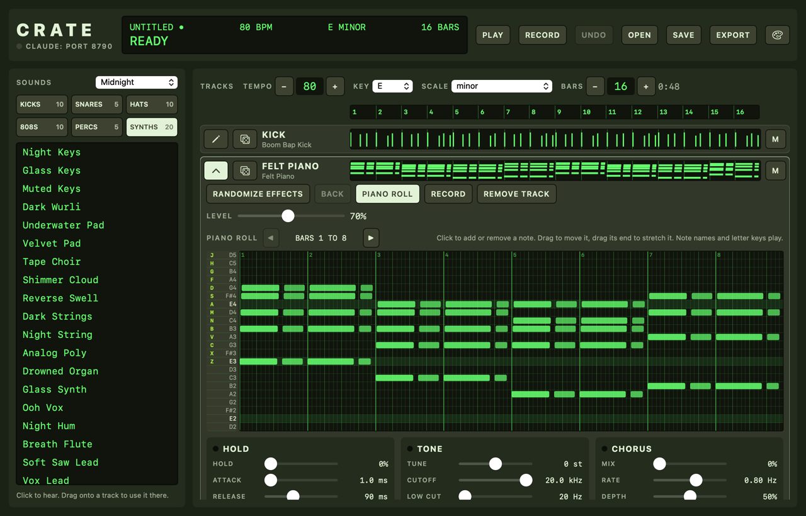
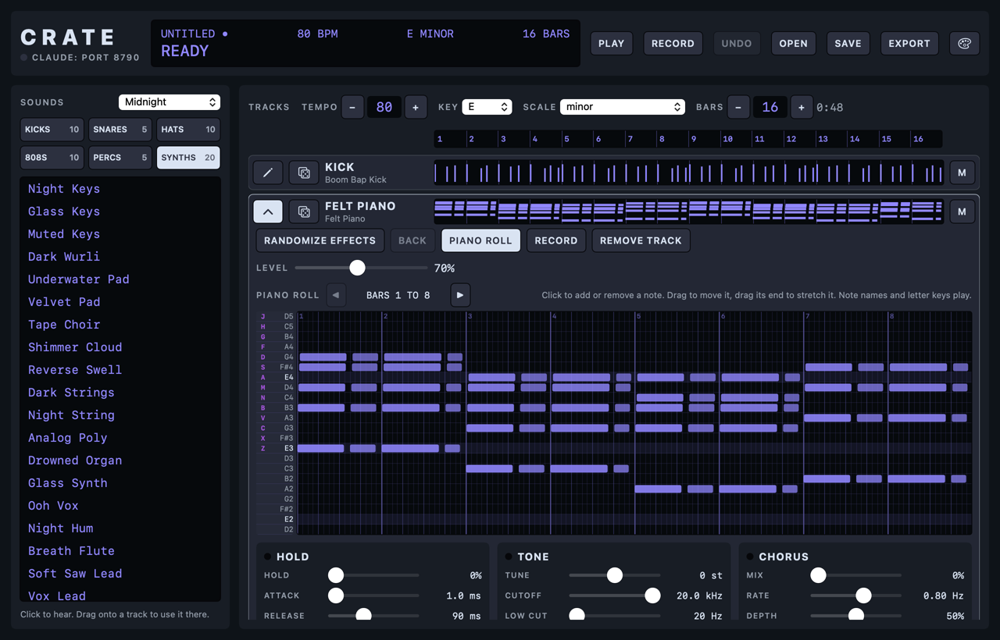
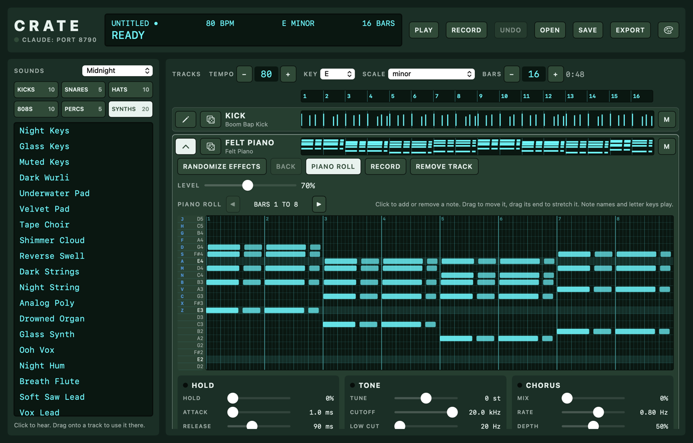
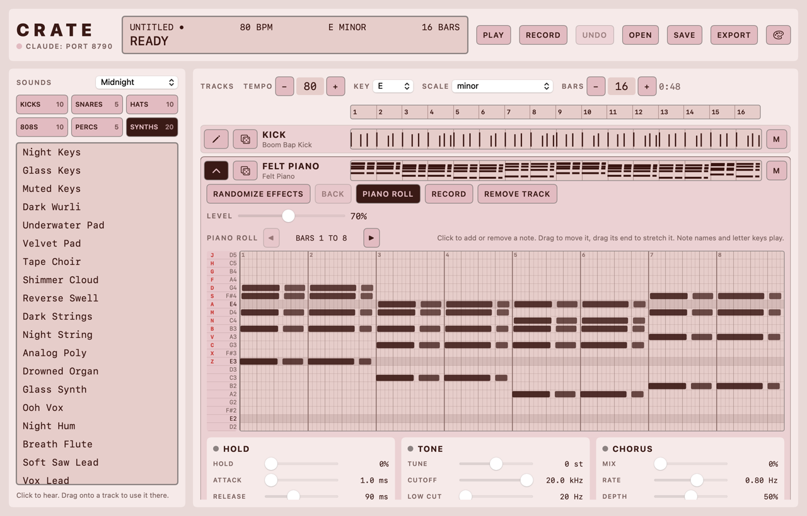
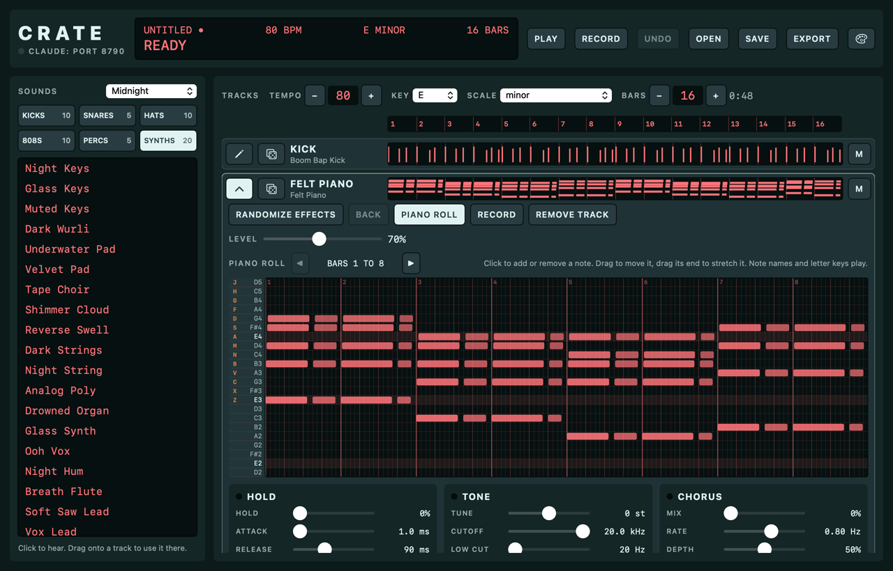
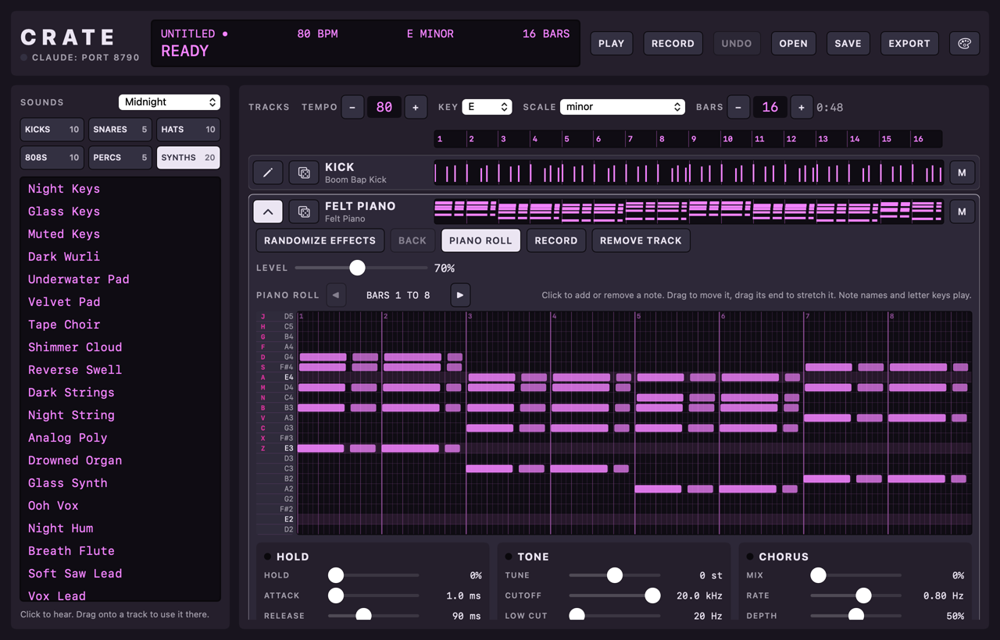

# Crate

A small music app for the Mac that Claude can play. A song is a stack of tracks. Each track plays one sound through its own effects, and the patterns come from three places: Claude writes them from what you describe, you play them on the letter keys, or you click them into the piano roll.



## What it does

- **Tracks.** Each track plays one sound. Its effects stay out of the way until you open the track with the pencil.
- **Effects on every track.** Hold (keeps a note at full level for its whole length, with attack and release), tone (tune, cutoff, low cut, drive, lo-fi), chorus, flanger, phaser, compressor, delay, reverb and EQ. The master has a compressor, EQ and limiter.
- **Versions.** A part can have several versions, shown as lanes under the track. Click one to hear it in place. Mastering choices work the same way.
- **Piano roll.** Click to add or remove a note, drag to move it, drag its end to change the length. The rows are the notes of the key, so nothing lands out of key. The note names on the left play when clicked, and the letter keys on the keyboard play the open track.
- **Sections.** Click a section to see it in the piano roll. Shift-click or right-click to copy, cut, paste, loop, duplicate or delete it. On a track's lane these work on that track; on the ruler they work on every track.
- **Dice.** The dice on a track gives it a random sound of the same kind with random effects. Inside the track, Randomize effects rolls the effects only.
- **Projects.** Songs are saved as `.crate` files in `~/Music/Crate` and exported as WAV.
- **Colors.** A palette window sets every color, with Randomize, Undo and Reset.



## Colors

The same window in six random palettes from the Colors window.

| | |
|---|---|
|  |  |
|  |  |
|  |  |

## Sound packs

Five packs, 262 sounds, all made from scratch by synthesis and all tuned to one key so they move together when the song's key changes.

| Pack | Sounds | Style |
|---|---|---|
| Starter | 22 | Basics |
| Lofi | 60 | Dusty drums, soft subs, keys and pads |
| Midnight | 60 | Late-night R&B and trap: layered drums, 808s, pads, voices, synths |
| Afterglow | 60 | Retro 80s R&B and synthwave |
| Blackout | 60 | Dark, hard trap |

The scripts that build Midnight, Afterglow and Blackout are in `scripts/` (Python with numpy).

## Build and run

You need macOS 14 or later and Apple's command line tools (Swift 5.9 or later).

```sh
./make-app.sh
open Crate.app
```

The app is built on your own Mac and is not signed for distribution.

## Let Claude play it

While Crate is open it runs an MCP server on your Mac at `http://127.0.0.1:8790/mcp`. It only accepts connections from the same Mac.

With Claude Code:

```sh
claude mcp add --transport http crate http://127.0.0.1:8790/mcp
```

Then ask for things in plain words: "an 8 bar melody in C# minor", "three versions of a bass that follows the kick", "lay it out as intro, verse, chorus", "master it and give me three options".

The tools Claude gets: `get_session`, `set_song`, `set_track`, `write_pattern`, `offer_variations`, `choose_take`, `copy_bars`, `clear_bars`, `set_plugins`, `offer_masters`, `choose_master`, `save_project`, `open_project`, `list_projects`, `new_project`, `set_colors`, `quantize`.

## Checks

The app binary can test itself from the command line. None of these change your songs.

```sh
.build/release/Crate --selftest path/to/Song.crate   # copy, paste, cut, loop, the dice, the piano roll's edits
.build/release/Crate --uitest                        # real clicks, drags and key presses sent into a hidden copy of the window
.build/release/Crate --render out.wav --song song.json
.build/release/Crate --screenshot out.png --demo --colors 11
```

## License

No license has been chosen yet.
